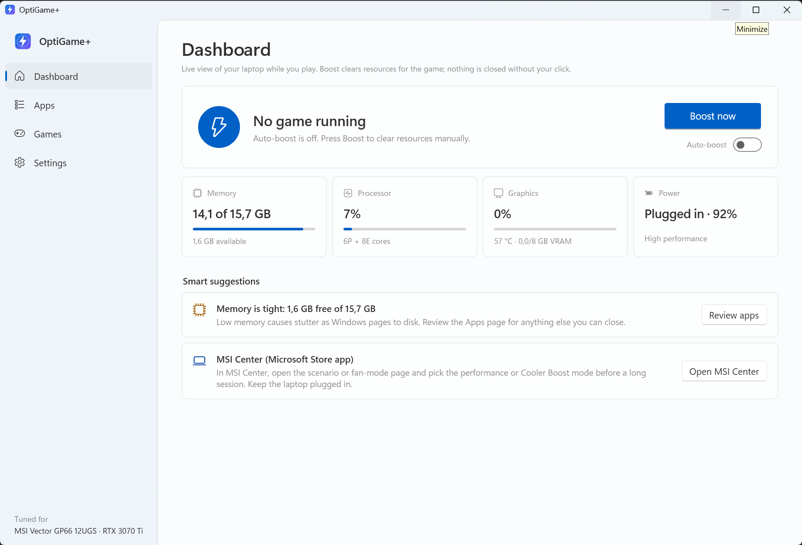
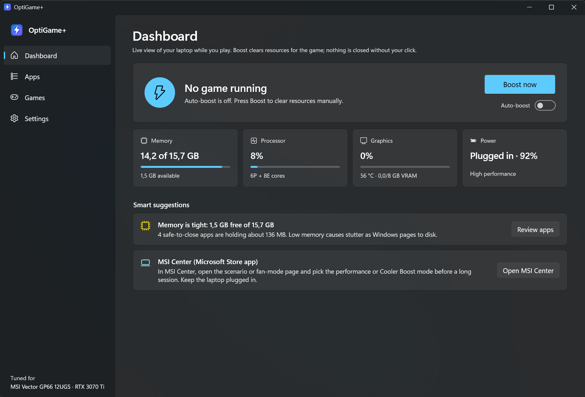
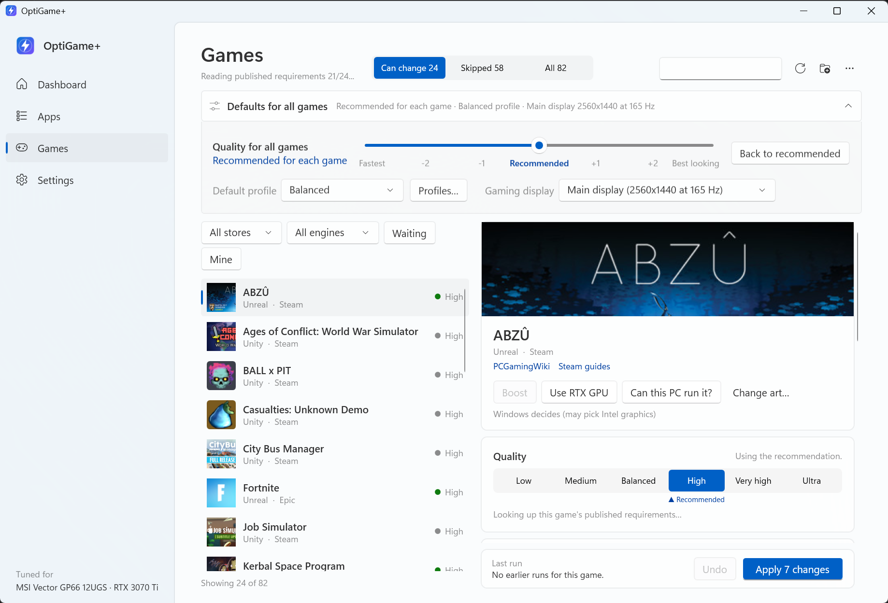
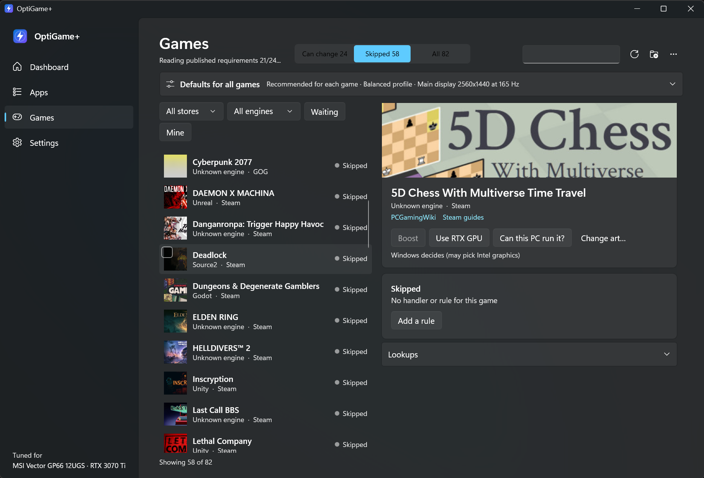
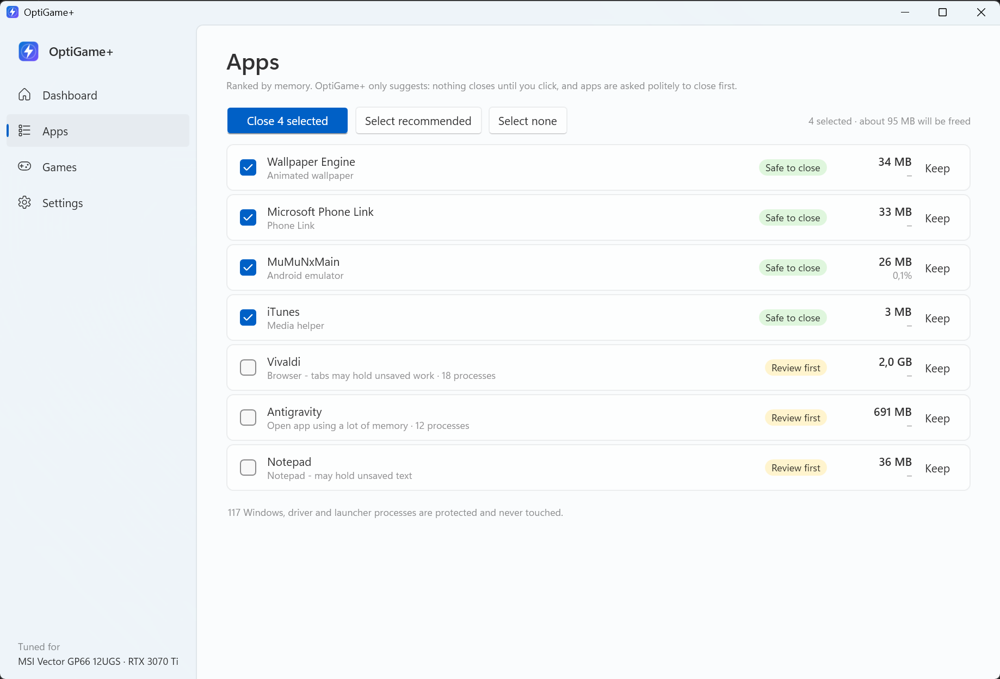
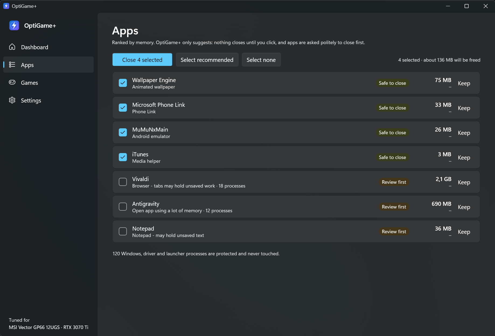
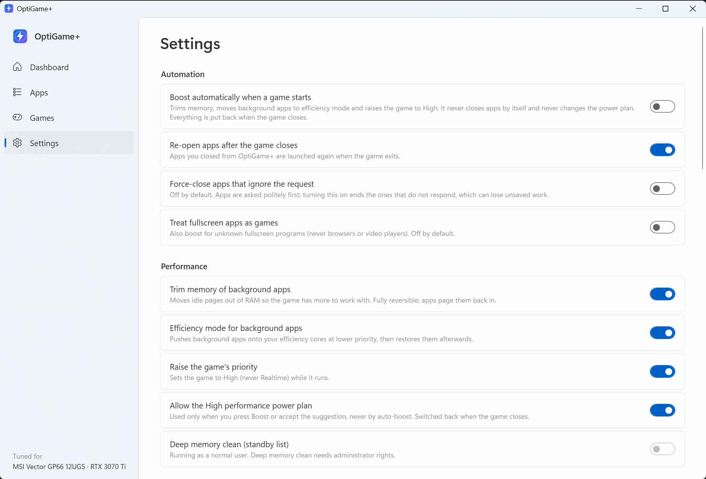
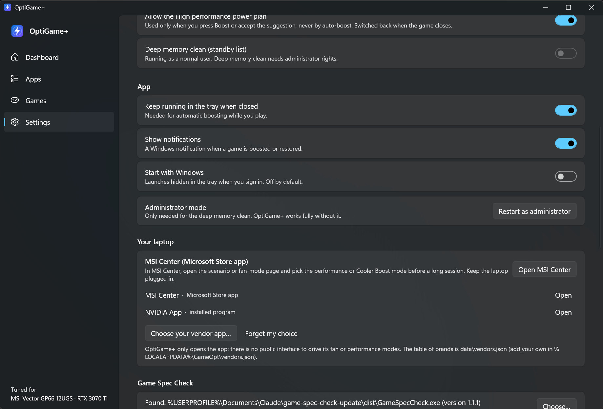

# OptiGame+

One Windows app for gaming laptops. It finds the games installed on your PC, recommends graphics
settings for each one, shows every change before writing it, applies it with a backup and lets
you undo it. While you play it also clears resources for the game that is running: it trims
background memory, moves background apps to efficiency mode and raises the game's priority, and
puts everything back when the game closes. It works on games that GPU vendor tools do not know
about, because it reads each game's engine settings directly instead of relying on a list of
supported titles.

OptiGame+ is **GameOptimizer and GameClear merged into one app**. GameOptimizer found games and
set their graphics; GameClear (the live resource clearer) is now the Dashboard and Apps pages.
They share one game list, one hardware profile and one Windows 11 look.

OptiGame+ is the sister project of
[Game Spec Check](https://github.com/yourbirthcertificate/game-spec-check), which answers
whether this PC can run a game. Each game has a **Can this PC run it?** button that opens Game
Spec Check on that game. They share the graphics card table, and OptiGame+ reuses the
requirement lookups Game Spec Check has already cached.

## Screenshots

Light and dark follow Windows. Paths in the app are shown as `%LOCALAPPDATA%` and `%USERPROFILE%`.

| | Light | Dark |
|---|---|---|
| Dashboard |  |  |
| Games |  |  |
| Apps |  |  |
| Settings |  |  |

## About this project

- **A personal tool.** It was made for the author's own use and is shared as is, with no support and no promise of updates.
- **Written with AI.** The code was written by Claude, an AI model from Anthropic, through Claude Code. It has had no professional review or security audit, and some of its choices will be wrong for some games.
- **Noncommercial use only.** It is licensed under the PolyForm Noncommercial License 1.0.0. Personal, hobby and study use is fine. Commercial use is not.
- **No donations.** The author is not accepting donations or sponsorship.

## The pages

Current version: see [CHANGELOG.md](CHANGELOG.md).

| Page | What it does |
|---|---|
| **Dashboard** | The front screen: a big **Boost** button, Auto-boost switch, live memory, processor, graphics and power meters, and smart suggestions (memory pressure, a hot GPU, running on battery, power plan, which graphics chip a game uses). |
| **Apps** | What could be closed to free memory. Closing is always your click, politely first (no force-kill unless you turn it on), with optional re-open afterwards. Browsers and documents are never pre-ticked and ask first. |
| **Games** | One list for Steam, Epic, GOG and folders you add. A list on the left, the selected game on the right: art, quality steps with the recommended one marked, the exact changes with tick boxes, frame rate and display settings, **Boost**, **Use RTX GPU**, **Can this PC run it?**, and **Apply** with **Undo**. |
| **Settings** | Boost options, your laptop's own app (MSI Center and others), Game Spec Check, game art, updates, history and backups, profiles, benchmarks, the rule wizard, and import or export of your choices. |

### What auto-boost does (and never does)

Only reversible things: it trims background memory, moves background apps to efficiency mode
(EcoQoS and below-normal priority) and raises the game to High (never Realtime). All of it is
restored when the game closes. It never closes an app, never switches the power plan, and never
touches Windows components, drivers, anti-cheat, launchers, voice chat, overlays or developer
tools. The power plan and the per-game graphics-chip preference are one-click suggestions.
Standby-memory purging is administrator-only and off by default. What it learns stays on this PC:
un-tick a suggestion twice and it is kept; close a reviewed app twice and it is suggested.

A game is detected with confidence when it runs from a library folder, is a `-Win64-Shipping`
build, is on the built-in list, or is on your list. A fullscreen app is only a "likely game"
and is not boosted unless you turn that on.

### Your laptop's own app

OptiGame+ reads the maker and model from the BIOS (`HKLM\HARDWARE\DESCRIPTION\System\BIOS`) and
looks them up in [`data/vendors.json`](data/vendors.json): MSI Center, ASUS Armoury Crate,
Lenovo Vantage and Legion Space, HP OMEN Gaming Hub, Dell and Alienware Command Center, Acer
PredatorSense and NitroSense, Gigabyte Control Center, Razer Synapse, and the NVIDIA App. It
finds the installed app by its Store package family or its install path and shows an **Open**
button and a short cooling tip; the "GPU is running hot" suggestion points at that app. Add or
replace entries in `%LOCALAPPDATA%\GameOptendors.json`. For an unknown brand, **Choose your
vendor app** remembers the program you pick. OptiGame+ only opens these apps: they have no public
interface to drive their fan or performance modes.

### Game art

Each game shows its art. Order: an image you chose, the cache, Steam's own library cache on this
PC, then (with **Fetch game art online** on) Epic's catalog image, GOG's product lookup, Steam's
image server by app id, a Steam store search by exact title for games with no id, and SteamGridDB
if you add a free key. The last resort is the game's own icon. Only ids go out, or the title for a
game that has none, and images are accepted only from those services' hosts.

### Updates and install

The setup program (`OptiGame-Setup-<version>.exe`) installs for the current user without
administrator rights to `%LOCALAPPDATA%\Programs\OptiGame`, with a Start menu entry and optional
desktop shortcut and **Start with Windows** (off by default). Once a day (switch off in Settings)
OptiGame+ asks GitHub's releases for a newer version; nothing about the PC is sent. **Install
update** downloads the setup, checks its SHA-256 against the digest GitHub lists, closes the app,
installs and starts it again. A download without a digest, or from anywhere but this project's
releases, is refused. Build it yourself with `installeruild.ps1` (needs Inno Setup 6).

### Coming from GameClear or GameOptimizer

- Your **backups, history, profiles, benchmarks and cache** stay where they were:
  `%LOCALAPPDATA%\GameOpt`. Nothing is moved, so every earlier run can still be undone.
- GameClear's `%AppData%\GameClear\data.json` (settings, learned apps, your game list) is read once
  into `%LOCALAPPDATA%\GameOpt\live.json` the first time OptiGame+ starts. The old file is left alone.
- Quit GameClear before running OptiGame+ (both would boost). If GameClear's **Start with Windows**
  was on, switch it off there; OptiGame+ has its own setting.
- The command line is now `optigame` (`gameopt` is the same program). `--data-dir FOLDER` keeps
  everything in another folder, which is how the tests run.
- Testing the app on a PC where you are playing: start it with `--no-auto --data-dir <temp folder>`.

## How it works

1. **Hardware.** It reads the graphics card and its memory, the processor and RAM, and every
   connected display: the mode Windows is using right now (resolution and refresh rate,
   fractions included, such as 59.94 Hz) and the modes the display supports.
2. **Games.** It finds games in every Steam library (`libraryfolders.vdf`), the Epic Games
   Launcher, GOG (its registry entries) and folders you add yourself. The same folder found
   through several sources is listed once, with every source shown. A library on a drive that
   is not connected is reported and skipped.
3. **Engine and settings.** It works out each game's engine and where that engine keeps its
   settings, or uses a rule file for the game.
4. **Recommendation.** Each game gets a recommended quality step from its published
   requirements (see below).
5. **Preview, apply, undo.** Every change is listed as `old -> new` with a tick box. Applying
   backs up each file and registry value first. History shows every run and can undo it.

## Quality steps and recommendations

Every game has a slider with six steps: Low, Medium, Balanced, High, Very high and Ultra, and
starts at the step recommended for that game on your PC.

The recommendation compares your graphics card with the card the publisher recommends on
Steam (or PCGamingWiki when Steam lists none), using a table of about 360 cards shared with
Game Spec Check. Requirement lists usually assume 1080p, so a bigger screen raises the bar
(about 1.5x for 1440p). About 0.75x of the recommended card or more gives High, 1.1x Very high,
1.4x Ultra.

Each recommendation shows what it rests on:

| Label | Meaning |
|---|---|
| Published | The publisher's recommended card, recognized in the table |
| Min. spec | Only a minimum card is listed; about 1.6x it stands in for "recommended" |
| Year | No card listed; older games get one or two steps above the PC-wide step |
| PC-wide | No requirement data (or offline); the step for this PC in general |
| Unknown GPU | This PC's card is not in the table, so no per-game comparison is possible |
| measured | A benchmark you imported and marked preferred exists; it is shown beside the estimate and never replaces it |

Hover over "Recommended" to see the source, the assumptions, the age of the cached data, and
what the data cannot tell: processor limits, ray tracing and other heavy options, and a
laptop GPU's power limit. There are no confidence percentages, because the data does not
support them. Moving a game's slider overrides the recommendation; the ↺ button puts it back.

## Frame rate and display

These are separate from the quality step, and each can be set per game:

- **Frame cap:** keep the game's, automatic, none (where the game supports it), 30, 60, 90,
  120, 144 or any custom value. Automatic is 3 fps under the **active** refresh rate of the
  game's display (162 fps at 165 Hz, 56 fps at 59.94 Hz), never the highest rate the display
  could run at. A cap limits how fast a game renders. It does not make the hardware reach that
  rate, does not guarantee smoothness, and does not replace VSync.
- **Display:** the gaming display for all games, with per-game overrides. Choosing a display
  only changes what the tool aims for; it never changes Windows display settings. Plugging in
  a display or changing its refresh rate updates the app right away.
- **Resolution:** keep the game's, the display's native or current resolution, or any mode the
  display supports.
- **Display mode:** keep, the engine's usual fullscreen (Unreal exclusive, Unity borderless),
  exclusive fullscreen, borderless or windowed.
- **VSync:** keep, on or off.

When a game's handler cannot control an option, the game's settings panel says so and the
option is left alone. Unity games, for example, keep their frame cap and VSync in their own
code or menus.

## Keep my settings

- In a game's **Settings** panel, tick what to keep as the game has it: resolution, display
  mode, VSync, frame cap, render scale, textures, other quality settings.
- In the **preview**, untick any single change to leave it out of this run only, or choose
  **Always keep** to leave it out every time (shown in the game's panel, where "Stop keeping
  these" resets it).

A kept change is never written: the plan is rebuilt without it, the preview shows exactly what
will be written, and the backup and stale-preview checks cover the same plan.

## Profiles

A profile is a named set of preferences: quality (an offset from each game's recommendation,
or a fixed step), frame cap, display, resolution, display mode, VSync and settings to keep.
Built in:

| Profile | Settings |
|---|---|
| Balanced (default) | Recommended quality, native resolution, the engine's usual fullscreen, VSync off, automatic cap |
| Quiet | One step below the recommendation and a 60 fps cap. Less rendering work per second; actual heat and noise depend on the game and the PC |
| Competitive | Two steps below the recommendation, no cap where supported, exclusive fullscreen, VSync off |
| Graphics only | Recommended quality; resolution, display mode, VSync and cap kept as the game has them |

Create, duplicate, rename, edit and delete your own in **Settings > Game optimizer tools > Profiles**, set one as
the default, or assign one to a game in its Settings panel.

Precedence, highest first: what you set in a game's own panel, the profile assigned to the
game, the default profile, then Balanced. For quality, a step set by hand on the game's slider
wins; otherwise the profile's quality applies, and the **All games** slider shifts every
offset-based profile by -3 to +3 steps. Fixed-step profiles ignore that slider.

## Library

The **Games** page is a list with the selected game beside it. Search by name, switch between
**Can change**, **Skipped** and **All**, filter by store and engine, or show only games with
changes waiting or your own choices. Hover a row to tick it; ticking two or more shows
**Preview N** and **Optimize N** under the list, and the **...** menu has **Optimize all supported
games**. Each starts with a preview. A single game shows its changes in the panel itself, with a
tick box each, so you read exactly what will be written before pressing **Apply**; **Undo** reopens
the restore preview for its last run.

Games the tool cannot change say why: no handler or rule, settings not created yet, settings
location not found, unsupported format, ambiguous settings, or game running. Where it helps,
the row offers **Open settings folder**, **Add a rule** or **Launch once, then rescan**.

Manual and GOG games have no Steam app id. You can link one in the game's Settings panel for
requirement lookups; the source ("linked by you") is shown. The tool never guesses an id from
a similar name.

## History and restore

**Settings > Game optimizer tools > History and restore** lists every run. For each one you can see the changes, pick a
game or the whole run, and preview a restore in one of two modes:

- **Undo the optimizer's changes only** (default). Only the keys the optimizer changed are put
  back, so later edits to other settings stay. A key changed again since the optimize is a
  conflict: it is shown and left alone.
- **Put the full backup back.** Each file or value is replaced by its backup, including
  anything changed since. Use it when a merge is not possible (older runs, files that can no
  longer be read).

Every restore backs up the current state first, so it can itself be undone, and it refuses to
run while a game is open or when a file changed after the restore preview.

## Benchmarks

**Settings > Game optimizer tools > Benchmarks** imports frame-time captures, without any in-game overlay:

- GameOptimizer CSV: a header row with a column named `frametime_ms`, one row per frame, in
  milliseconds. Other columns are ignored.
- PresentMon CSV, as written by PresentMon, CapFrameX and others (`MsBetweenPresents`, or
  `FrameTime` / `MsBetweenDisplayChange` in newer versions).

Definitions: **average FPS** = frames / total captured time; **1% low FPS** = 1000 / the 99th
percentile frame time (nearest rank), so 99% of frames were delivered at least that fast.
Files with too few frames (under 100), non-numeric or negative values, or units that look like
seconds are rejected with the reason. Each result records the game, profile, step, resolution,
frame cap, hardware, time and your notes about the scene or route, and shows a frame-time graph.
Comparing two results flags different durations, resolutions, caps or hardware. Results stay in
`%LOCALAPPDATA%\GameOpt\benchmarks`; marking one preferred shows it beside the recommendation.

## Rules and the rule wizard

Game-specific knowledge lives in JSON rules: built-in ones in [`rules/`](rules/README.md), your
own in `%LOCALAPPDATA%\GameOpt\rules`. **Settings > Game optimizer tools > Rule wizard** (or `optigame-cli rule wizard`)
creates one: pick the settings file or registry key, take a "before" snapshot, change one
setting in the game and close it, take an "after" snapshot, pick the keys that changed, give
their values (one for every step, or six), check, save, and preview. Snapshots only read.
Two snapshots show two values, so the wizard never invents the other steps.

`optigame-cli rule validate` checks rules against the same rules as the app; there is also a JSON
schema at [`rules/rule.schema.json`](rules/rule.schema.json). See
[CONTRIBUTING.md](CONTRIBUTING.md) for sending a rule for a game.

## Preferences export and import

**Settings > Game optimizer tools > Export preferences** writes a versioned file with your profiles, the All games setting,
per-game choices, kept settings and your rules. Folders and display names go in a separate
machine section. Game saves, backups, raw registry data and benchmarks are never included.
**Import** shows what would be added, replaced or in conflict before anything is saved, with an
explicit choice of merge or replace, and asks for a new location for any added folder that does
not exist on this PC.

## What it changes per engine

| Engine | Where | What |
|---|---|---|
| Unreal | `%LOCALAPPDATA%\<Project>\Saved\Config\Windows*\GameUserSettings.ini` | Resolution, fullscreen mode, VSync, frame cap (0 = none), the eleven `sg.*` scalability groups, render resolution 100% |
| Unity | `HKEY_CURRENT_USER\Software\<Company>\<Product>` | Resolution, display mode, and the quality level when the game uses Unity's built-in levels |
| Source | `<game>\<mod>\cfg\video.txt` | Resolution, display mode, VSync, effect, shader and texture detail |
| Others | A rule file for that game | Whatever the rule lists (ini, json, Valve text, Unreal `.sav`, registry) |

Texture quality is capped by graphics memory. Unreal `.sav` files are only edited when writing
the parsed file back reproduces the original byte for byte.

## Safety

- **Never touches a running game**, for optimize and restore alike.
- **Backups first**, in `%LOCALAPPDATA%\GameOpt\backups\<run>`. The last 20 runs are kept.
- **No guessing.** Unreadable files, duplicate keys, unexpected value types and unknown formats
  are left alone, with the reason in the preview.
- **Stale previews are refused** if a file changed after the preview.
- **Steam Cloud** saves get a warning; if Steam asks which copy to keep, pick the one on this PC.

## What it sends over the internet

Only Steam app ids, to Steam's store API and PCGamingWiki, to read published requirements for
games the tool can change. Game art (switch off in Settings) sends the Steam app id, the GOG
product id, or, for a game with neither, its exact title to Steam's store search (and to
SteamGridDB only if you set a key). The update check is one request to GitHub's releases API. Answers are cached for a week in `%LOCALAPPDATA%\GameOpt\cache`, and
Game Spec Check's cache is read too (`optigame-cli shared-cache add <checkout>\.cache` for a source
checkout). Nothing about your hardware is sent. Without a connection the tool keeps working with
cached data and falls back to the PC-wide step. `--offline` skips lookups on any command.

## Running it

Download `OptiGame-Setup-<version>.exe` from the Releases page and run it. It installs for your
user (no administrator needed), adds a Start menu entry, and updates itself from then on.
`OptiGame.exe` and `optigame-cli.exe` are also attached as plain files. They need Windows 10 or
11 and nothing else (the .NET runtime is included). The files are not code-signed, so Windows may
show "Windows protected your PC" the first time: choose "More info", then "Run anyway".

### Command line

`optigame-cli help` lists everything (`gameopt` is the same program under its old name). The main commands:

```
optigame-cli hw | scan | recommend [--game NAME] [--details] | why --game NAME
optigame-cli preview|apply [--game NAME]... [--step STEP] [--exclude SETTING_ID]... [--offline]
optigame-cli history [--run ID]
optigame-cli restore [--run ID] [--game NAME] [--full] [--apply]
optigame-cli step --offset N | step --game NAME STEP|reset
optigame-cli game show|set|keep|unkeep NAME ...
optigame-cli profile list|show|create|rename|delete|set|default|assign ...
optigame-cli display list | display use \\.\DISPLAYn|main
optigame-cli library list|add PATH|remove PATH
optigame-cli rule list|validate|snapshot|diff|wizard ...
optigame-cli bench import|list|show|compare|prefer|delete ...
optigame-cli prefs export FILE | prefs import FILE [--replace] [--take-imported] [--map OLD=NEW] [--apply]
optigame-cli vendor [list] | vendor open [NAME]       optigame-cli speccheck [--game NAME]
```

`preview` and `restore` without `--apply` never write anything.

### From source

You need the .NET 10 SDK.

```
dotnet test
dotnet run --project src/OptiGame.App
dotnet run --project src/OptiGame.Cli -- scan
dotnet publish src/OptiGame.App -c Release -r win-x64
dotnet publish src/OptiGame.Cli -c Release -r win-x64
pwsh installer/build.ps1        # app, command line tool and the setup program (needs Inno Setup 6)
```

## Known limits

- Games that never started have no settings yet, so there is nothing to change.
- Unity games with their own settings menu only get resolution and display mode, unless a rule
  covers them. Without type information in a Unity build, only the first quality level name can
  be read.
- Source 2 games and engines without a handler (Elden Ring, Helldivers 2 and others) need a rule.
  The only verified built-in rule so far is VOID/BREAKER; see [CONTRIBUTING.md](CONTRIBUTING.md).
- The card scores and headroom bands are rough. Requirement lists say nothing about frame rate,
  so a recommendation is a starting point, not a prediction.
- PCGamingWiki refuses the app's own lookups from some connections; those games fall back to
  their release year.
- Display detection reads Windows' display configuration. Multi-display setups, fractional rates
  on real TVs and hot-plugging were tested with synthetic data and one laptop panel only.

## Legal

[LICENSE](LICENSE) (PolyForm Noncommercial 1.0.0), [NOTICE](NOTICE), [CREDITS.md](CREDITS.md).
This project is not affiliated with Valve, Epic Games, GOG, Unity, PCGamingWiki, NVIDIA, AMD,
Intel or Microsoft, or with the makers of any game.
